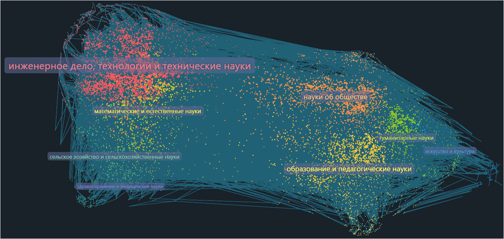
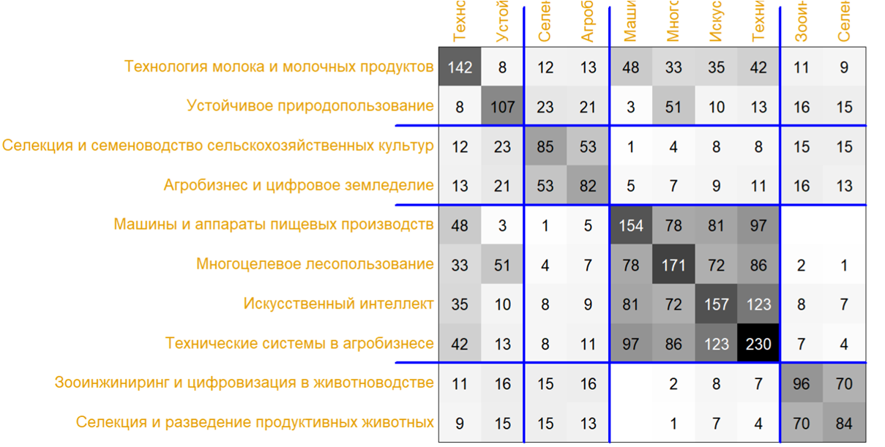
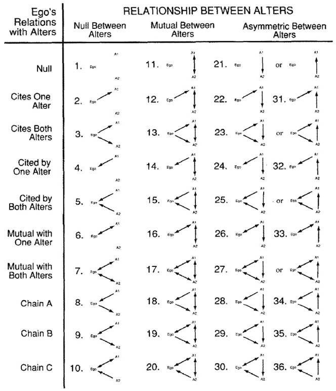
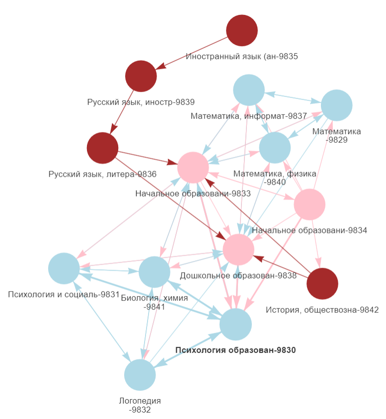

class: left
<br><br>


```{r setup, include=FALSE}
knitr::opts_chunk$set(cache = TRUE,
                      message = FALSE,
                      warning = FALSE)
options(htmltools.preserve.raw = FALSE)
```


<div style="font-size:42pt;">
**Экологии образовательных программ и дисциплинарные иерархии:<br>анализ «сетей рассмотрения» абитуриентов в 328 российских вузах**
<div style="font-size:30pt;">

<br><br>Артур Печерских (ЕУСПб, ЦИАНО)<br><u>apecherskikh@eu.spb.ru</u> | @<u>archibard</u> в tg

---
<div style="font-size:10pt;color: white;"> empty-space
<div style="font-size:42pt;color: black">**О проекте / дисклеймер**

<div style="font-size:30pt">

- первоначальный интерес, - к данным о поступлении с Госуслуг и методам из сетевого анализа, которые редко удается применить
- предварительные результаты

<div style="font-size:26pt">

**лето 2025**         частичный сбор данных с Госуслуг для задач в ЕУ<br>
**осень 2025**        пробные попытки сбора и оценки покрытия<br>
**ноябрь 2025**       сбор всего массива о бакалаврских программах<br>
**весна 2026**        периодические попытки анализа<br>
**май 2026**          подача заявки на ИВО<br>
**октябрь 2026**      сегодня

---
<div style="font-size:10pt;color: white;"> empty-space
<div style="font-size:42pt;color: black">**Вопросы**

<div style="font-size:24pt">

  1. Данные о поступлении традиционно располагались на индивидуальных вебсайтах вузов. Можем ли мы использовать тому, что представлено в унифицированном виде на Госуслугах?

  2. "Сети рассмотрения" (consideration networks) студентов обычно анализируются из перспективы связности: какие программы выбираются вместе, в какой последовательности, и так далее (<span style="color:red">references</span>). Альтернативные вопросы и сценарии исследования предлагает позиционистский подход к сетям:
  
    - какие "роли" могут занимать образовательные программы?
    - какие у них есть корреляты на уровне университетов и кодов программ?
  
---
<div style="font-size:10pt;color: white;"> empty-space
<div style="font-size:42pt;color: black">**Вселенная приема в российские вузы на Госуслугах**

<div style="font-size:21pt">
<br>


---

<div style="font-size:10pt;color: white;"> empty-space
<div style="font-size:42pt;color: black">**Две традиции сетевого анализа**

<div style="font-size:21pt">
<br>

|  | ego | complete | multiple |
|-----------|-----------|-----------|-----------|
| <b>Connectionist</b><br>networks as pipes<br> | structural holes<br>density<br>mixing models<br>size | community detection<br>reachability<br>homophily<br>degree distribution<br>social balance | multi-level networks<br>multi-level models of multiple networks |
| <b>Positional</b><br>networks as roles | local roles<br>(Mandel 1983) | relational block models<br>motifs | patterns <i>in</i> networks<br>patterns <i>of</i> networks |

<br>
<p align="right">(James Moody 2018)</p>

---
<div style="font-size:10pt;color: white;"> empty-space
<div style="font-size:42pt;color: black">**Две традиции сетевого анализа**

<div style="font-size:21pt">

Представим, что у нас есть реляционные данные об образовательном выборе: что выбирают студенты, что выбирается вместе и/или приоритезируется.

|  | какие вопросы задают |
|-----------|-----------|-----------|-----------|
| <b>Connectionist</b><br>networks as pipes<br> | связность сети<br>топология/структура<br>индикаторы отдельных узлов |
| <b>Positional</b><br>networks as roles | роли и позиции<br>эквивалентные узлы<br>наборы "ролей"<br>отношения между позициями |


---
<div style="font-size:10pt;color: white;"> empty-space
<div style="font-size:42pt;color: black">**Первый подход - в исследованиях образовательного выбора**

<div style="font-size:17pt">

Baker, R. (2018). Understanding college students’ major choices using social network analysis. _Research in higher education_, _59_(2), 198-225.

Candia, C., Encarnação, S., & Pinheiro, F. L. (2019). The higher education space: connecting degree programs from individuals’ choices. _EPJ Data Science_, _8_(1), 39.
<br>

Соколов, М., Кнорре, А., & Сафонова, М. (2014). Теории высшего образования и процесс выбора специальности абитуриентами: социально-сетевой анализ. _Университетское управление: практика и анализ_, _2_(90), 6-25.


Науменко, В. Р., Бегичева, С. В., & Назаров, Д. М. (2023). Управление образовательным выбором абитуриентов на основе социально-сетевого анализа данных приемной комиссии Уральского государственного экономического университета. _Цифровые модели и решения_, _2_(3), 23-36.

---
<div style="font-size:10pt;color: white;"> empty-space
<div style="font-size:42pt;color: black">**Первый подход - в исследованиях образовательного выбора**

<div style="font-size:17pt">

Baker, R. (2018). Understanding college students’ major choices using social network analysis. _Research in higher education_, _59_(2), 198-225. <span style="color:red">"survey given to 297 students in 11 classes... N. California Community College"</span>

Candia, C., Encarnação, S., & Pinheiro, F. L. (2019). The higher education space: connecting degree programs from individuals’ choices. _EPJ Data Science_, _8_(1), 39. <span style="color:red">"355,173 (PHES) and 691,159 (CHES) individual applications."</span>

Соколов, М., Кнорре, А., & Сафонова, М. (2014). Теории высшего образования и процесс выбора специальности абитуриентами: социально-сетевой анализ. _Университетское управление: практика и анализ_, _2_(90), 6-25. <span style="color:red">БелГУ, 140 списков поступаюших, "3921 абитуриент, 6011 заявлений..."</span>

Науменко, В. Р., Бегичева, С. В., & Назаров, Д. М. (2023). Управление образовательным выбором абитуриентов на основе социально-сетевого анализа данных приемной комиссии Уральского государственного экономического университета. _Цифровые модели и решения_, _2_(3), 23-36. <span style="color:red"><br>УрГЭУ, 723 абитуриента, 18 направлений подготовки, 7896 заявлений</span>

---
<div style="font-size:10pt;color: white;"> empty-space
<div style="font-size:42pt;color: black">**Первый подход - в исследованиях образовательного выбора**

<div style="font-size:19pt">

ля-ля
ля

картинка из Baker2018?


---
<div style="font-size:10pt;color: white;"> empty-space
<div style="font-size:42pt;color: black">**Первый подход на данных Госуслуг /1**

<div style="font-size:21pt">
Проекция программ из сети 12,168 очных бакалаврских программ и 502,432 абитуриентских выборов (основных мест).<br>Каждый узел – одна программа. Связь – наличие хотя бы 6 общих ID абитуриентов.


```{r, echo=FALSE, out.width="80%", fig.align = 'center'}

```

---
<div style="font-size:10pt;color: white;"> empty-space
<div style="font-size:42pt;color: black">**Первый подход на данных Госуслуг /2**

<div style="font-size:21pt">
То же, что и на предыдущем слайде, но все программы сгруппированы по 51 направлению подготовки (2 уровень в ОКСО).<br>
Наличие связи - наличие общих абитуриентов между кодами специальностей.<br>
Цветом показана верхнеуровневая классификация программ из ОКСО.


```{r, echo=FALSE, fig.align = 'center'}
library(igraph)
library(visNetwork)
library(tidyverse)
library(widgetframe)

set.seed(23)

g_comm3 <- read_rds("img-for-slides/net51-inter.rds")

V(g_comm3)$value = V(g_comm3)$value*10

graph <- visIgraph(g_comm3) %>% 
  visIgraphLayout(layout = "layout_with_fr") %>% 
  visInteraction(
    tooltipStyle = "position: fixed; visibility: hidden; padding: 10px; font-size: 24px; max-width: 400px; background-color: #f5f4ed; border: 1px solid #808074; border-radius: 5px; box-shadow: 3px 3px 10px rgba(0, 0, 0, 0.2);"
  )

frameWidget(graph, width = "1000px", height = "500px")
```


---
<div style="font-size:10pt;color: white;"> empty-space
<div style="font-size:42pt;color: black">**Первый подход на данных Госуслуг /3**
<div style="font-size:21pt">
Отношения между программами в одном университете:

<div style="font-size:17pt">
<br><b>Вологодская государственная молочнохозяйственная академия им. Н.В. Верещагина</b><br>
10 		программ в данных 2025 года (vs. 11 на самом деле), 7 специальностей<br>
620 	уникальных абитуриентов, 1,308	связок абитуриентов и программ

```{r, echo=FALSE, out.width="75%", fig.align = 'center'}

```

---
<div style="font-size:10pt;color: white;"> empty-space
<div style="font-size:42pt;color: black">**Второй подход - как?**

<div style="font-size:21pt">

Есть разные способы найти эквивалентные позиции («роли») в сети:

  - Structural equivalence,
  - Automorphic equivalence,
  - Regular equivalence,
  - **Role equivalence = local equivalence (Burt 1990)**


<br>

<div style="font-size:18pt">
(Rawlings et al., 2023, Ch. 10)


---
<div style="font-size:10pt;color: white;"> empty-space
<div style="font-size:42pt;color: black"><b>Роли и локальная эквивалентность</b>

<div style="font-size:22pt">

.pull-left[
Если получить частотности вхождения каждого узла в кажый из 36 типов триад, то можно очень точно определить их "роли".

В контексте исследования,<br>"роль" - это то, как складываются отношения образовательной программы внутри университета с другими образовательными программами, в случае наших данных, – в терминах доминирования в умах общих потенциальных студентов (абитуриентов).
]

.pull-right[
```{r, echo=FALSE, out.width="90%"}

```
]


---
<div style="font-size:10pt;color: white;"> empty-space
<div style="font-size:42pt;color: black"><b>Порядок действий на массиве из Госуслуг</b>

<div style="font-size:18pt">


  1. **фильтрация случаев:** только программы бакалавриата, только очные формы обучения, только списки на "основные места", только в тех вузах, где > 10 программ и отсутствует не более трети списков (случай нескольких университетов)<br>Всего: 328 университетов, 10,327 программ
  2. **матрицы отношений между программами:** для каждого вуза получить матрицу с программами, где на пересечении число студентов, выбравших программу <i>i</i>, а не программу <i>j</i>.
  3. **нормализация** размеров программ, отсечение маленьких пересечений (н. 14 человек, кто подался и на "востоковедение", и на "программирование", из сотен поступающих на эти программы).
  4. **бинаризация матриц:** если две программы разделяют не менее 10% потенциальных студентов от общего числа заявлений той или иной программы, та из них, которая в >60% выборов оказывается "выше" в приоритете, получает 1 (значения ниже - взаимная связь).
  5. **перепись триад:** посчитать вхождения каждой программы во все 36 типов триад (с нормализацией).
  6. **кластеризация внутри университетов:** с помощью CONCOR (см. Rawlings et al., 2023, Ch. 10). 
  7. **кластеризация второго уровня:** иерархическая кластеризация (метод Варда) по таблице со средними хар-ками блоков (все еще из переписи триад). Всего блоков для кластеризации: 1,259.
  8. **интерпретация и описание полученных "ролей"**


---
<div style="font-size:10pt;color: white;"> empty-space
<div style="font-size:42pt;color: black"><b>Галерея случаев</b>


```{r, echo=F, warning=F, message=F, out.height="600px", out.width="100%"}
library(trelliscope)

d <- read_rds("img-for-slides/tbl-for-gallery-of-cases.rds") %>%
  filter(!str_detect(university, "ФГБОУ ВО \\«ХГПУ\\»|Уральский государственный университет физической культуры|Сибирский государственный университет водного транспорта|Российский государственный художественно-промышленный университет им. С.Г. Строганова|Приморский государственный аграрно-технологический университет"))

d <- d[order(d$uni.id, decreasing = TRUE), ]

#d <- as_trelliscope_df(d %>% 
#                         mutate(filepath = str_c("C:/Users/Arthur Pecherskikh/Desktop/pet-projects/2026-10 gosuslugi-return/trelliscope-imgs/",
#                                                 row_number(), "-img.png")),
#                       name = "Галерея случаев")

trell <- d %>% 
  select(university, everything()) %>% 
  mutate(filepath = str_c("trelliscope-imgs/", uni.id, "-img.png")) %>% 
  select(-uni.id) %>% 
  as_trelliscope_df(name = " ") %>% 
  # Убираем боковую панель и делаем одну колонку для вертикального списка
  set_default_layout(ncol = 3, sidebar = FALSE)

view_trelliscope(trell)
```


---
<div style="font-size:10pt;color: white;"> empty-space
<div style="font-size:42pt;color: black"><b>Результаты: двухуровневая кластеризация</b>

<div style="font-size:18pt">

Пять кластеров / "ролей", представлены в виде графика из анализа корреспонденций<br>(5 кластеров, - показаны числами; по ср. вхождениям в 36 типов триад, - показаны изображениями)


```{r, echo=FALSE, out.width="75%", fig.align = 'center'}
knitr::include_graphics("img-for-slides/ca-5clusters-viz.png")
```

---
<div style="font-size:10pt;color: white;"> empty-space
<div style="font-size:42pt;color: black"><b>Результаты: двухуровневая кластеризация</b>

<div style="font-size:18pt">

Интерпретация осей:

  - **(X)  изолированность/участие в сетях дележа абитуриентов**<br>от null-триады до той, где все три связи взаимны
  - **(Y) успешность на рынке абитуриентских предпочтений**<br>от *"Ego<-A1, Ego<-A2"* до *"Ego->A1, Ego->A2"*
 

 
| "роль" | *N* | описание |
|----------|----|:-----------|
| 1 | 388 | программы, предпочитаемые внутри университета другим при совместном выборе |
| 2 | 1495 |программы, которым предпочитают другие внутри университета при совместном выборе |
| 3 | 2883 | изолированные программы / программы, которым предпочитают другие |
| 4 | 5304 | изолированные программы, не конкурирующие внутри университета с другими |
| 5 | 243 | программы в "гуще событий": с переменным успехом конкурируют с большим числом других программ внутри университета |


---
<div style="font-size:10pt;color: white;"> empty-space
<div style="font-size:42pt;color: black"><b>Результаты: "роли" в одном университете</b>

<div style="font-size:20pt">

.pull-left[
**Государственный гуманитарно-технологический университет**<br>(г. Орехово-Зуево)<br><br>
2 роль - голубым,<br>третья роль - красным,<br>пятая роль - розовым<br><br>


]

.pull-right[
```{r, echo=FALSE, out.width="100%", fig.align = 'center'}

```
]

---
<div style="font-size:10pt;color: white;"> empty-space
<div style="font-size:42pt;color: black"><b>Что еще можно смотреть?</b>

<div style="font-size:23pt">

Корреляты ролей:
  - цена (предварительно, ср. наивысшая в 5 кл.),
  - распределение по вузам разных типов,

- наши данные. цены и пр.
- мониторинг??


---
<div style="font-size:10pt;color: white;"> empty-space
<div style="font-size:42pt;color: black"><b>Заключительные замечания</b>

<div style="font-size:18pt">

  - **Госуслуги как источник данных о приеме:** пока имеют множество ограничений (на уровне представленности программ и их описаний, особенно см. случаи программ магистратуры и аспирантуры), однако, в теории, являются наиболее детализированным ресурсом об индивидуальных выборах в высшем образовании.<br>
  
  - Появление такого источника позволяет **менять подходы к сетевым исследованиям отношений между образовательными программами, и ставить новые вопросы.** Ввиду нового масштаба, можно исследовать сразу множество отдельных университетских сред, искать в них общее и различное. Язык "ролей", "позиций" и "блоков" (Lorrain & White, 1971). Но для них нужно и серьезное исследовательское воображение.<br>
  
  - В качестве примера в работе показано, как автоматически определить пять "ролей", которые могут исполнять бакалаврские программы в российских университетах. Условно, они характеризуются **включенностью/исключенностью из сети абитуриентских выборов** и **мерой "власти/успешности" в отношениях с другими программами**. "Роли" в редких случаях определяются кодами программ, делая их самостоятельной описательной характеристикой.


---
<div style="font-size:10pt;color: white;"> empty-space
<div style="font-size:42pt;color: black"><b>Библиография</b>

<div style="font-size:18pt">


  - Baker, R. (2018). Understanding college students’ major choices using social network analysis. _Research in higher education_, _59_(2), 198-225.
  - Candia, C., Encarnação, S., & Pinheiro, F. L. (2019). The higher education space: connecting degree programs from individuals’ choices. _EPJ Data Science_, _8_(1), 39.
  - Lorrain, F., & White, H. C. (1971). Structural equivalence of individuals in social networks. _The Journal of mathematical sociology_, _1_(1), 49-80.
  - Moody, J. (2023). Raltional block model (youtube-lecture).
  - Burt, R. S. (1990). Detecting role equivalence. _Social networks_, _12_(1), 83-97.
  - Rawlings, C. M., Smith, J. A., Moody, J., & McFarland, D. A. (2023). _Network analysis: integrating social network theory, method, and application with R._ Cambridge University Press.
  - Соколов, М., Кнорре, А., & Сафонова, М. (2014). Теории высшего образования и процесс выбора специальности абитуриентами: социально-сетевой анализ. _Университетское управление: практика и анализ_, _2_(90), 6-25.
  - Науменко, В. Р., Бегичева, С. В., & Назаров, Д. М. (2023). Управление образовательным выбором абитуриентов на основе социально-сетевого анализа данных приемной комиссии Уральского государственного экономического университета. _Цифровые модели и решения_, _2_(3), 23-36.

